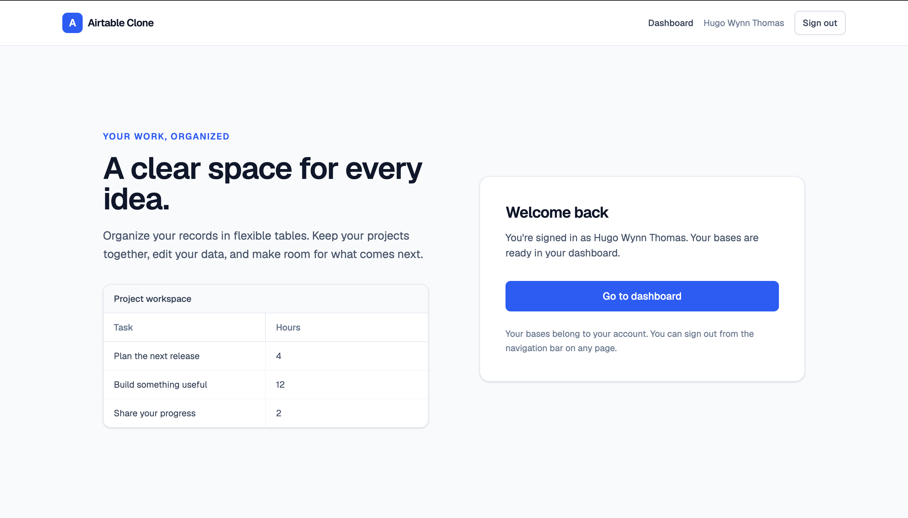
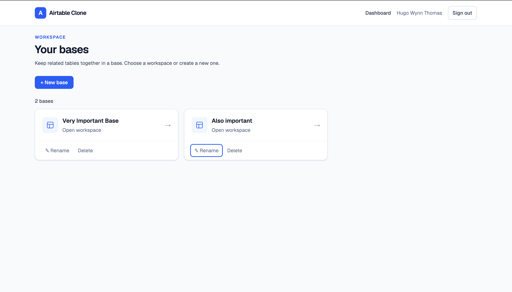
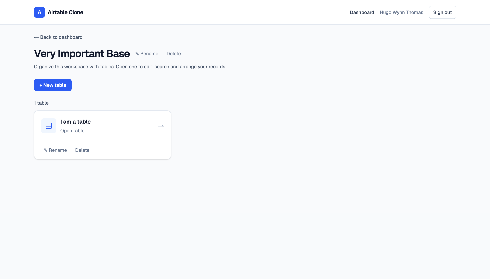
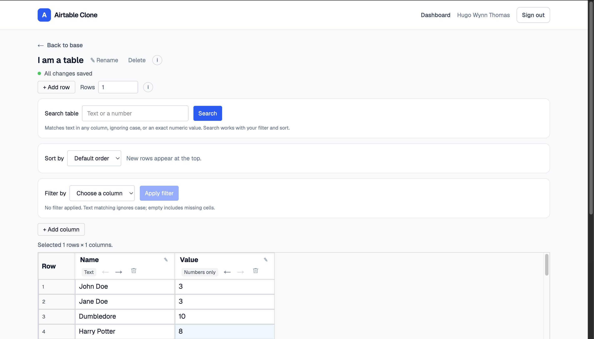

# Deployment and portfolio presentation

The project owner reports that the app is deployed on Vercel with Neon PostgreSQL.

**[Live demo](https://airtable-clone-roan-iota.vercel.app/)** — Google sign-in required.

This guide documents release configuration, verification and use of the existing product screenshots. Updating these instructions does not publish the app or modify its database.

## Project configuration

Use the existing Vercel project if it is already linked to this repository. The application root is `airtable-clone`, relative to the Git repository root, not the enclosing local `Airtable` workspace.

| Setting          | Value                     |
| ---------------- | ------------------------- |
| Framework        | Next.js                   |
| Root Directory   | `airtable-clone`          |
| Install Command  | `npm ci`                  |
| Build Command    | `npm run build`           |
| Output Directory | Next.js default (`.next`) |

Vercel applies settings relative to the selected app directory. See [Vercel build configuration](https://vercel.com/docs/builds/configure-a-build).

`npm ci` runs the existing Prisma client-generation postinstall hook. The build command does not run migrations or seed data. Keep migration decisions separate from application builds; `npm run db:generate` is misleadingly named and runs `prisma migrate dev`, so it is not a deployment command. Coordinate any required migration for the intended database before releasing code that depends on it.

## Environment and Google sign-in

Configure these server-side variables for the intended Vercel environment:

| Variable               | Purpose                                                                 |
| ---------------------- | ----------------------------------------------------------------------- |
| `NEXTAUTH_SECRET`      | Stable, private session/auth secret; required by this app in production |
| `GOOGLE_CLIENT_ID`     | OAuth client ID used by the Google provider                             |
| `GOOGLE_CLIENT_SECRET` | Matching OAuth client secret                                            |
| `DATABASE_URL`         | PostgreSQL connection URL for this deployment                           |
| `AUTH_URL`             | Intended stable HTTPS application origin                                |

Use separate development/preview database credentials. Do not copy the local `AUTH_URL=http://localhost:3000` into production, and remove conflicting legacy `NEXTAUTH_URL` values. Keep all secrets in the hosting environment rather than the repository. Do not set `SKIP_ENV_VALIDATION` for the release build.

Register `https://YOUR_DEPLOYMENT_HOST/api/auth/callback/google` in the Google OAuth client's authorized redirect URIs. Replace the example host with the actual deployment host. Keep the localhost callback for development. If the OAuth consent app is in testing, intended reviewers must be allowed test users.

Auth.js can infer the host on supported platforms; a stable explicit `AUTH_URL` makes the intended callback origin clear for this project. Preview OAuth needs a compatible callback configuration; a working production callback alone does not establish preview sign-in. See [Auth.js deployment guidance](https://authjs.dev/getting-started/deployment).

## Release verification

Before publishing, run from `airtable-clone/`:

```sh
npm run check
npm test
npm run build
```

A fresh build downloads the configured Google font. Verify in production mode locally with `npm run start` and follow the Phase 5 checklist in [LOCAL_DEVELOPMENT.md](./LOCAL_DEVELOPMENT.md). Existing results are in [VALIDATION.md](./VALIDATION.md).

After an authorized deployment, verify Google sign-in/out, protected-route redirects, base/table navigation, edit persistence after reload and a 2×3 range paste. Verify failure rollback and resizing persistence using disposable demo records. Confirm `/test` returns 404 and `/opengraph-image` returns the branded PNG. The preview image contains only static product copy, with no account or workspace data.

The public demo URL is linked from both READMEs with a Google sign-in note. Update those links if the public origin changes. Record deployment verification separately from the existing local build and PostgreSQL results.

## Product screenshots

The four desktop screenshots are stored in `docs/screenshots/` at the repository root. They show the journey from the home page through bases and tables to a populated spreadsheet.

### Home page

`Sign-In-Page.png` shows the signed-in **Welcome back** state with a dashboard link. Caption it as the signed-in home page; it does not show the Google sign-in button.



### Bases dashboard

`Bases.png` shows two workspace cards and controls for creating, renaming and deleting bases. Use it to introduce workspace organization.



### Tables in a base

`Tables.png` shows a base containing one table and its management controls. Use it to explain the Base → Table hierarchy.



### Spreadsheet view

`Sheet.png` shows sample Text and Number records, row and column controls, and the search, sort and filter panels. The view uses default order with no search or filter applied.



## Using the screenshots in the portfolio

Lead a root README Screenshots section or portfolio project page with `Sheet.png` to show the core editing interface, followed by `Bases.png` for workspace organization. Include the home and table-list images when a fuller walkthrough is useful. Keep descriptive alt text and captions alongside images, and retain the live-demo link with its Google sign-in note.

Paths are relative to the Markdown document. The root `README.md` can embed the grid with:

```markdown

```

Documents inside `airtable-clone/`, including this guide, use `../docs/screenshots/Sheet.png`. Preserve filename capitalization for case-sensitive hosts. For an external portfolio, copy the selected images into that site's assets and use its asset URLs.

The current captures display the signed-in account name. Before reusing them elsewhere, confirm that displaying the name is intended; otherwise recapture with a suitable demo profile or redact personal details. The home screenshot includes the name in both the header and welcome panel.

Record production verification and performance results separately in [VALIDATION.md](./VALIDATION.md). These screenshots illustrate the interface; they do not establish OAuth success, persistence, rollback or mobile behavior. Continue using the static `/opengraph-image` asset for branded link previews.

## Refreshing or extending the captures

Use a signed-in development session with fictitious records. Wait until saves finish, capture at 100% browser zoom and exclude browser chrome, extensions and unrelated tabs. Keep controls and sample values readable, and preserve the original aspect ratio when displaying images.

Refresh existing files when the interface changes. Useful additions are:

- A signed-out home page showing **Continue with Google**.
- A populated grid with search, filter and sort applied.
- A grid with a selected 2×3 range.
- Mobile dashboard and grid views showing stacked controls and horizontal scrolling.

Suggested browser viewports are 1440 × 900 for desktop and 390 × 844 for mobile; image pixel dimensions may differ with display scale. Embed additional files only after they exist, and describe the state actually shown.
